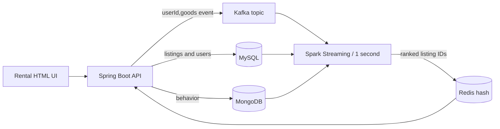

# Behavior-driven rental recommendation

Listing attributes are tokenized and hashed into 150-dimensional TF-IDF vectors. The worker reads a user's stored listing IDs from MongoDB and joins their attributes to build a preference vector. For a current listing ID it uses that listing's content; textual feature events are retained for compatibility with the original frontend. Similarity uses cosine distance, with zero norms yielding zero similarity. Consumed listings are excluded and a current listing's province restricts candidates when available. The top ten IDs are cached in Redis under the user ID.

The backend uses Redis when a list exists. On cache miss, it uses the original province-filtered MySQL query. This is a cold-start fallback, not a proven improvement metric. Reading a cached list triggers a history-based refresh event. Feature indexing happens once at worker startup; newly imported listings require a worker restart to refresh the index.

This is Spark DStream microbatch processing, not a Flink rental application. MongoDB persistence and Kafka publication are separate writes. Kafka auto-commit and Redis writes do not establish exactly-once processing; retention, replay, deduplication, checkpoint recovery, resource scaling and cache expiry need further engineering. The text tokenizer does not provide specialized Chinese word segmentation.
